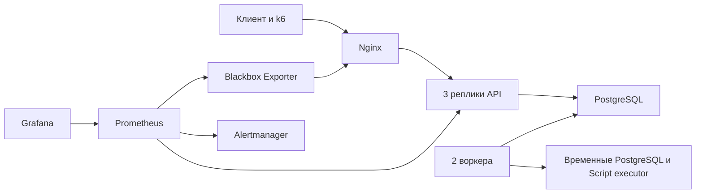

# Демонстрационный стенд автопроверки

Текущий стенд на Mac запущен во встроенном Kubernetes Docker Desktop.
[Инструкция Kubernetes](KUBERNETES.md) описывает запуск, масштабирование и приёмку.
Ниже приведена инструкция для варианта на Docker Compose.

Стенд работает на одном Docker-хосте. На macOS он использует имеющийся Docker
Desktop со встроенной Linux-VM. На Linux подойдёт локальный Docker Engine.
Нужны Docker Compose, Python 3.12+ и локальный дистрибутив 1С:Элемент Скрипт
10.0.2-1 с SQL API и JDBC. По умолчанию скрипт берётся из
`script_u_10.0.2_1` в корне репозитория. Другой путь можно передать в
`SCRIPT_RUNTIME_ROOT`.

## Запуск

Выполните команды из корня репозитория.

```bash
python3 deploy/autocheck/demo/demo.py up
python3 deploy/autocheck/demo/demo.py status
python3 deploy/autocheck/demo/demo.py validate
```

`up` собирает образ из текущего рабочего дерева, сохраняет SHA коммита и
фактический ID образа для результатов проверки, загружает закреплённые образы,
создаёт локальные секреты при первом запуске и ждёт готовности сервисов.
Данные PostgreSQL, Grafana, Prometheus и Alertmanager сохраняются в именованных
томах. Артефакты работ, секреты и резервные копии находятся в
`deploy/autocheck/demo/.state` с доступом владельца на хосте. Webhook-доставка
отключена, результаты доступны через API.



| Компонент | Адрес или назначение |
|---|---|
| Nginx | [Готовность API](http://127.0.0.1:8088/health/ready) |
| API × 3 | Балансировка Nginx по адресам Docker DNS, проверка готовности по HTTP |
| Worker × 2 | Общий лимит в PostgreSQL, до двух работ одновременно, изолированные контейнеры для SQL |
| PostgreSQL | Состояние работ, слоты, lease и журнал событий |
| Migrate | Одноразовая миграция перед стартом API, воркеров и notifier |
| Notifier | Ведёт реестр демонстрационных клиентов и отдаёт сигнал готовности |
| Grafana | [Дашборд автопроверки](http://127.0.0.1:3000/d/autocheck-demo/autocheck-demo), просмотр без входа |
| Prometheus | [Цели сбора метрик](http://127.0.0.1:9090/targets) |
| Blackbox Exporter | Проверяет путь через Nginx каждые пять секунд |
| Alertmanager | [Активные алерты](http://127.0.0.1:9093/), без внешней рассылки |

Все опубликованные порты привязаны к IPv4 loopback. API и PostgreSQL доступны
соседним контейнерам по внутренней сети. Имена переменных для изменения портов —
`GATEWAY_PORT`, `DEMO_GRAFANA_PORT`, `DEMO_PROMETHEUS_PORT` и
`DEMO_ALERTMANAGER_PORT`. Compose-проект называется `element-autocheck-demo`.
Ограничения CPU, памяти и числа процессов заданы в Compose. Воркеры используют
Docker socket для управления временными контейнерами проверок. Журнал Compose
объединяет логи по контейнерам, а Docker ограничивает размер файлов логов.

## Сценарии показа

```bash
python3 deploy/autocheck/demo/demo.py load
python3 deploy/autocheck/demo/demo.py logs -f gateway api worker
```

k6 запускается на 45 секунд с целевой частотой 15 запросов в секунду к
`/v1/capacity`. На Grafana видны HTTP-коды, средние задержки, распределение
запросов по репликам и занятость слотов. k6 оценивает p95 HTTP и не отправляет
реальные работы. Частота и длительность настраиваются через `DEMO_LOAD_RATE`
и `DEMO_LOAD_DURATION`.

Скрипт приёмки использует `httpx` и `PyYAML` из окружения проекта
(`deploy/autocheck/requirements.lock`).

```bash
.venv/bin/python deploy/autocheck/demo/verify.py engine
.venv/bin/python deploy/autocheck/demo/verify.py failover
```

- `engine` одновременно отправляет восемь запросов на резервирование, ждёт два
  допуска и шесть ответов 429, загружает демонстрационный дамп и проверяет два
  результата реального SQL-исполнения, JSON-артефакты и освобождение слотов.
  По умолчанию используется `Dvizhok-dev-final.xdump`.
- `failover` оставляет одну реплику API, опрашивает Nginx, ждёт предупреждение
  о потере реплик, включает остановленные контейнеры обратно и проверяет
  закрытие алерта. Запускайте отдельно от измерения k6.
- `demo.py pause` временно закрывает приём новых работ. `demo.py resume`
  открывает его. Изменения используют текущий ETag настроек.

## Эксплуатация

```bash
python3 deploy/autocheck/demo/demo.py backup
python3 deploy/autocheck/demo/demo.py stop
```

`backup` сохраняет логический дамп управляющей PostgreSQL и проверяет, что
`pg_restore` читает его оглавление. Для восстановления результата вместе с
файлами нужна также согласованная копия каталога `.state/data`. Команда `stop`
останавливает контейнеры с сохранением томов и локальных данных. Для продолжения
используйте `up`. API и воркеры имеют реплики на одном хосте. Хост, балансировщик и
управляющая PostgreSQL остаются единичными точками отказа.
