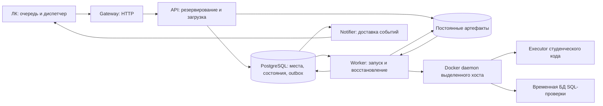
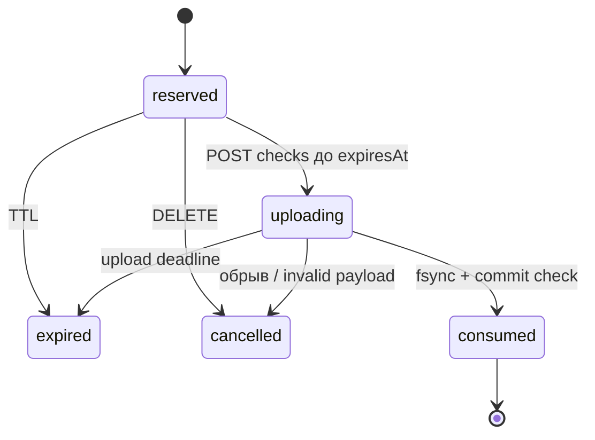
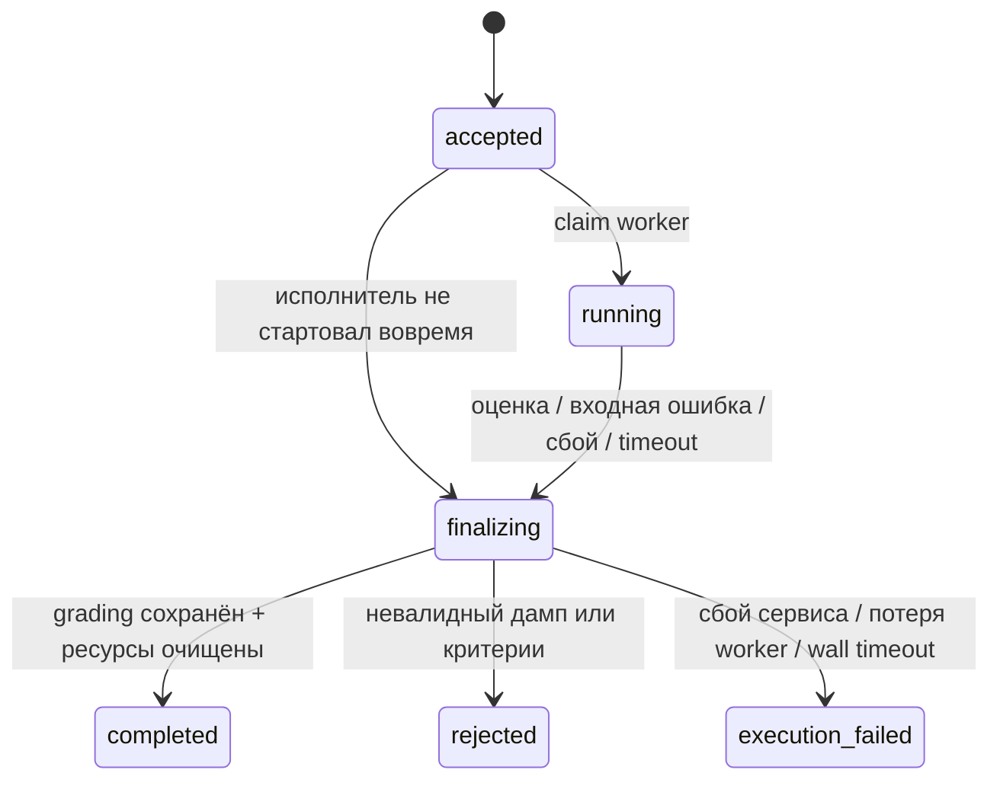

# Проект микросервиса автопроверки, версия 1.0

Дата: 14 октября 2026. Статус: проект для финального согласования, без реализации.

## 1. Решения и границы

Очередь студенческих работ, её порядок, приоритеты и число ожидающих перед
студентом принадлежат ЛК. Микросервис предоставляет ограниченные места исполнения,
резервирует место до загрузки файла, запускает существующий Element Test Engine и
доставляет результат. Внешней очереди работ в микросервисе нет. Таблица принятых
работ — журнал восстановления и передача уже занятых мест worker, а не дополнительный
неограниченный backlog. Между приёмом и запуском предусмотрено не более 10 секунд.

Критерии выбирает backend ЛК и передаёт отдельно от дампа. Микросервис сохраняет
неизменяемый снимок критериев каждого запуска. Каталога редактируемых заданий и CRUD
критериев в сервисе нет. Студент не получает токен сервиса и не выбирает критерии.

Первое развёртывание: один выделенный Linux-сервер, один Docker daemon, одна
экземплярная установка PostgreSQL, общий локальный каталог артефактов. Несколько
процессов API и worker на этом хосте допустимы, но все пользуются общей БД и общим
лимитом. Несколько независимых хостов требуют отдельного проекта файлового хранилища
и распределения executor; текущий Compose этого не обещает.

Файлы проекта:

- `deploy/autocheck/compose.yaml` — контейнеры и связи;
- `deploy/autocheck/service.yaml` — статическая конфигурация будущего сервиса;
- `deploy/autocheck/nginx.conf` — HTTP-шлюз;
- `deploy/autocheck/.env.example` — параметры размещения;
- `deploy/autocheck/README.md` — подготовка и проверка развёртывания;
- `docs/autocheck-openapi.yaml` — контракт OpenAPI 3.0.3;
- `docs/autocheck-webhook-openapi.yaml` — endpoint приёма результата в ЛК;
- `docs/autocheck-review-checklist.md` — критерии приёмки реализации.

## 2. Компоненты



| Контейнер | Ответственность | Доступ |
|---|---|---|
| `gateway` | Размер HTTP-тела, таймауты, proxy без предварительной буферизации дампа | API |
| `api` | Авторизация, места, потоковая загрузка, чтение результата, настройки | Управляющая БД и артефакты |
| `worker` | Диспетчер принятых работ, процесс движка, cleanup, lease recovery, retention | БД, артефакты, runtime и Docker socket |
| `notifier` | Outbox, HMAC-подпись, повторы callback | БД и исходящий HTTPS |
| `migrate` | Однократная миграция схемы и начальных настроек | БД |
| `postgres` | Транзакционное состояние сервиса | Только внутренняя сеть |

Executor и PostgreSQL каждой SQL-проверки создаёт worker динамически. Они не
являются сервисами Compose, не подключаются к `backend` и не используют БД
`autocheck`. Executor без SQL имеет `--network none`; SQL-сценарий получает свою
отдельную `--internal` сеть и временную БД. Docker-in-Docker не используется.

## 3. Контракт ЛК

Время в API — RFC 3339 UTC. Идентификаторы сервиса — UUID. `studentId`,
`assignmentId`, `submissionId`: `[A-Za-z0-9][A-Za-z0-9._:-]{0,127}`. `attempt`
положительное целое: повторная техническая попытка или переоценка имеет новый номер.
Идентификаторы студента и задания непрозрачны, ФИО и email сервису не нужны.

### 3.1. Зарезервировать место

`POST /v1/reservations`, JSON, `Authorization: Bearer …`, `Idempotency-Key`.

```json
{
  "submissionId": "submission-4815",
  "attempt": 1,
  "studentId": "student-127",
  "assignmentId": "task-orders",
  "criteriaVersion": "2026-10-14.1",
  "projectName": "Поставщик::УчебныйПроект",
  "runMode": "integration",
  "dump": {
    "format": "xdump",
    "sizeBytes": 20000000,
    "sha256": "aaaaaaaaaaaaaaaaaaaaaaaaaaaaaaaaaaaaaaaaaaaaaaaaaaaaaaaaaaaaaaaa"
  },
  "criteria": {
    "format": "zip",
    "sizeBytes": 8000,
    "sha256": "bbbbbbbbbbbbbbbbbbbbbbbbbbbbbbbbbbbbbbbbbbbbbbbbbbbbbbbbbbbbbbbb"
  }
}
```

Хеши примера условные. ЛК вычисляет реальные SHA-256 бинарных файлов до запроса.
`projectName` необязателен, нужен для выбора приложения в составном дампе.
`runMode` по умолчанию `isolated`; `integration` разрешается по клиенту и настройке
сервера. URL callback отсутствует: получатель привязан к авторизованному `clientId`.

Успешный ответ `201`:

```json
{
  "reservationId": "e3ca7d59-aa31-4c9c-a4da-65ff632ca8f7",
  "checkId": "90566acb-77e0-45d6-835f-e74748e89fbe",
  "status": "reserved",
  "expiresAt": "2026-10-14T18:02:00Z",
  "uploadUrl": "/v1/checks"
}
```

TTL — 120 секунд по часам PostgreSQL, отсчёт начинается после транзакции
резервирования. `checkId` генерируется заранее, но до загрузки работа доступна через
reservation, а `GET /checks/{checkId}` возвращает 404. Увеличивать TTL запросами
продления в v1 нельзя. ЛК резервирует только работы, файлы которых уже готовы.

При занятости — `429 capacity_full` и `Retry-After: 5`. При выключенном приёме,
недоступном worker, Docker, БД, runtime, недостатке диска или переполненном outbox —
`503 admission_unavailable`. Запрос не создаёт очередь внутри сервиса.

`GET /v1/reservations/{reservationId}` возвращает актуальное состояние.
`DELETE /v1/reservations/{reservationId}` освобождает неиспользованную резервацию
(`204`); повтор после `cancelled/expired` тоже `204`. При `uploading/consumed` —
`409 reservation_busy`; отмена начатой проверки не входит в v1. ЛК показывает её
результат как устаревший, если студент уже прислал новую сдачу.

### 3.2. Загрузить работу

`POST /v1/checks`, заголовки `Authorization`, `Idempotency-Key`, `X-Reservation-Id`;
`multipart/form-data` с ровно двумя частями: `dump` и `criteria`.
Другие поля, повторяющиеся части и файлы с неизвестным форматом отклоняются.
Метаданные берутся из reservation и не дублируются в multipart.

API **до чтения и разбора тела** проверяет авторизацию, владельца резервации,
идемпотентность и атомарно меняет `reserved → uploading`. Это middleware на уровне
ASGI/HTTP, а не обычный обработчик FastAPI после автоматического multipart parsing.
Nginx `proxy_request_buffering off` позволяет этой проверке выполняться без
предварительного приёма всего тела. Клиент может успеть отправить часть байтов до
раннего ответа; протокол не обещает нулевой передачи при отказе.

ЛК читает файл и формирует multipart потоком. API читает/пишет блоками, например
64 KiB, считает фактические размеры и хеши, не вызывает `read()` без размера.
Проверяется также суммарный размер с multipart overhead, включая chunked-запросы.
`Content-Length` полезен для раннего отказа, но не заменяет подсчёт байтов.

Успешный ответ `202` содержит `checkId`, `status: accepted`, `statusUrl`.
`202` означает: оба входа надёжно сохранены, их хеши совпали с заявленными,
метаданные и занятый слот зафиксированы в БД. Это ещё не оценка.

Ошибки размера/хеша/частей возвращают `413/422`, резервация закрывается как
`cancelled`, файлы удаляются после безопасной очистки. Обрыв соединения также
закрывает эту попытку загрузки. Для новой загрузки ЛК получает новый reservation и
новый ключ резервирования; номер `attempt` можно сохранить, если check ещё не принят.
Ключ загрузки можно повторить, если первая попытка не была committed.
При неизвестном исходе сначала выполнить GET reservation/check, а не слепой повтор.

Одновременная загрузка по одному reservation: одна начинает запись, другая получает
`409 upload_in_progress`. Повтор уже committed upload с тем же ключом возвращает
тот же `202` и `checkId` **до чтения тела**, даже если reservation уже consumed.

### 3.3. Получить состояние и результат

`GET /v1/checks/{checkId}` возвращает envelope сервиса:

```json
{
  "schemaVersion": "1.0",
  "checkId": "90566acb-77e0-45d6-835f-e74748e89fbe",
  "submissionId": "submission-4815",
  "attempt": 1,
  "studentId": "student-127",
  "assignmentId": "task-orders",
  "criteriaVersion": "2026-10-14.1",
  "status": "completed",
  "acceptedAt": "2026-10-14T18:00:20Z",
  "startedAt": "2026-10-14T18:00:21Z",
  "finishedAt": "2026-10-14T18:00:55Z",
  "inputHashes": {
    "dumpSha256": "aaaaaaaaaaaaaaaaaaaaaaaaaaaaaaaaaaaaaaaaaaaaaaaaaaaaaaaaaaaaaaaa",
    "criteriaSha256": "bbbbbbbbbbbbbbbbbbbbbbbbbbbbbbbbbbbbbbbbbbbbbbbbbbbbbbbbbbbbbbbb"
  },
  "engine": {"version": "0.1.0", "revision": "<git commit>", "imageDigest": "sha256:<64 hex>"},
  "grading": {"schemaVersion": "1.0", "status": "passed", "score": 10, "maxScore": 10,
    "unavailablePoints": 0, "feedback": []},
  "error": null,
  "delivery": {"status": "pending", "attemptCount": 0},
  "artifacts": [{"kind": "report.html", "available": true,
    "url": "/v1/checks/90566acb-77e0-45d6-835f-e74748e89fbe/artifacts/report.html"}]
}
```

Это сокращённый иллюстративный ответ: `grading` в реальном ответе содержит весь
валидный пакет существующей схемы `docs/grading-v1.schema.json`.
`grading.sourceHash` — хеш исходников по правилам движка; `dumpSha256` — хеш
переданного бинарного файла. Они имеют разный смысл и не обязаны совпадать.
Хеш пакета критериев также отличается от хеша нормализованных проверок, который
worker сохраняет дополнительно в provenance.

`GET /v1/checks?submissionId=…&attempt=…&limit=…&cursor=…` — сверка после обрыва
или рестарта ЛК; только записи своего клиента, keyset pagination, limit 1..100.
Фильтр `submissionId` обязателен, `attempt` опционален. ЛК хранит исходный
reservationId/checkId в своей записи и не делает массовую сверку каждую секунду.

Артефакты выдаются по аутентифицированной ручке
`GET /v1/checks/{checkId}/artifacts/{kind}`, без клиентского файлового пути.
Kinds: `grading.json`, `result.json`, `report.html`, `execution-plans.json`,
`runtime-evidence.json`. Для JSON — attachment; HTML — attachment с CSP sandbox и
`X-Content-Type-Options: nosniff`. Истёкший retention: `410 artifact_expired`;
ещё не созданный артефакт: `404 artifact_not_found`. Исходный дамп и скрытые критерии
через API не выдаются. Диагностика ограничивается контрактом пакетов; raw stderr,
секреты, пути хоста и connection strings не уходят в callback.

### 3.4. Capacity и настройки

`GET /v1/capacity` возвращает:

```json
{
  "maxConcurrentChecks": 4,
  "hardLimit": 8,
  "occupiedSlots": 3,
  "availableSlots": 1,
  "reserved": 1,
  "uploading": 1,
  "accepted": 0,
  "running": 1,
  "finalizing": 0,
  "cleanupBlocked": 0,
  "accepting": true,
  "settingsRevision": 3,
  "observedAt": "2026-10-14T18:00:00Z"
}
```

Это снимок, а не обещание места. В `occupiedSlots` входят все резервации, загрузки,
принятые, исполняемые, финализируемые и заблокированные очисткой работы. Поэтому
четыре резервации занимают все четыре места, даже если executor ещё не запущен.
`availableSlots = max(0, maxConcurrentChecks - occupiedSlots)`; если `accepting=false`,
availableSlots показывается как 0 независимо от арифметического остатка.

Административные `GET/PATCH /v1/admin/settings`:

```json
{"maxConcurrentChecks": 4, "accepting": true}
```

PATCH требует `If-Match: "3"`; GET/PATCH возвращают ETag revision. Несовпадение —
`412`, отсутствие — `428`. Диапазон 1..`hardLimit`; приостановка через
`accepting=false`, не через нулевую параллельность. Снижение лимита не убивает
работы и не отзывает живые резервации: временно `occupiedSlots` может превышать
новый лимит. Уже зарезервированные загрузки допускаются и при ручной паузе, если
исполнитель готов. Новые резервирования запрещены. Внешний hardLimit меняется
оператором через env и пересоздание worker после проверки ресурсов, не API.

`DEFAULT_MAX_CONCURRENT_CHECKS` используется только при первой миграции, когда
настройки отсутствуют. Перезапуск не затирает значение БД. Мигратор получает эти
env-параметры; worker сверяет их с сохранёнными settings и публикует hardLimit в
своём readiness. При значении БД выше нового hardLimit приём выключен до исправления
настройки оператором; действующие работы завершаются.

## 4. Состояния и время жизни



Начатая вовремя загрузка получает отдельный абсолютный deadline 180 секунд с момента
`uploading`; истечение исходных 120 секунд не обрывает её. Heartbeat загрузки каждые
5 секунд, отсутствие входящих байтов 30 секунд — abort. Heartbeat не продлевает
абсолютный deadline. Cleaner не освобождает место, пока жив writer или не выполнен
abort с fencing; после потери lease старый writer не может commit даже при оживлении.



В `finalizing` хранится предполагаемый `terminalStatus`. Даже при готовом grading
занятый слот не освобождается до подтверждённого удаления executor и временной БД.
Если Docker недоступен, запись остаётся finalizing, capacity показывает cleanupBlocked,
приём остановлен, readiness degraded, оператор видит событие/метрику.

`completed` означает наличие валидного grading, который может иметь `passed`,
`failed` **или `incomplete`**. Статусы критериев ERROR/TIMEOUT/UNSUPPORTED — факты
движка, не повод менять состояние завершённой сервисной работы или начислять ноль
от имени сервиса. `rejected/execution_failed` имеют `grading: null` и структурированную
ошибку. Сервис не создаёт фиктивную оценку при сбое.

Deadline работы — 900 секунд от `acceptedAt`, включая ожидание запуска и cleanup.
Если cleanup после deadline невозможен, slot остаётся занятым до реальной очистки.
Процесс движка: отдельная process group, stdout/stderr ограничены и хранятся только
для оператора. Heartbeat работы 5 секунд, lease 30 секунд. Потеря lease не означает
разрешение нового исполнения: recovery сначала fencing и удаление старых ресурсов.
Автоматического повтора оценки в v1 нет. Новую попытку с новым attempt решает ЛК.

Обычный рестарт worker прекращает приём, ждёт до 60 секунд, затем завершает группы
процессов и cleanup. Незавершённые running становятся execution_failed после
подтверждённой очистки. Accepted, не claimed до рестарта, могут быть запущены в
пределах исходного start deadline без второго исполнения.

## 5. Транзакции, файлы и восстановление

### 5.1. Резервирование и единый лимит

Одна singleton-строка `service_settings` блокируется `SELECT … FOR UPDATE` на
короткую транзакцию. Под этой блокировкой обрабатываются reserve, release и PATCH:
проверить idempotency, readiness и параметры; посчитать активные capacity_claims;
проверить лимит; создать reservation + claim + idempotency в одной транзакции.
Порядок locks везде: settings → claim/reservation → check → idempotency/outbox.
Проверка срока использует clock PostgreSQL, не часы разных контейнеров.

Capacity GET не захватывает слот. `COUNT < limit` без синхронизации запрещён.
В v1 достаточно сериализации коротких транзакций singleton lock; это не lock на
время проверки. Claim/release имеют уникальные ограничения и не могут удвоить или
дважды освободить слот. Просроченные reserved не считаются свободными, пока cleaner
или reserve-транзакция не закроет claim; загрузки и finalizing так не освобождаются.

Worker забирает accepted запись через короткий `FOR UPDATE SKIP LOCKED`, меняет её
на running, фиксирует `leaseOwner` и монотонный `fence`. Все публикации результата
сравнивают fence и lease. Restart/recovery меняет fence раньше cleanup. Worker не
держит транзакцию открытой во время Java/Docker выполнения.

### 5.2. Файловая фиксация

```text
SERVICE_DATA_ROOT/
  staging/<uploadId>/                 # недоступно как принятая работа
  checks/<checkId>/input/dump.xdump
  checks/<checkId>/input/criteria.*    # исходные байты, неизменяемый снимок
  checks/<checkId>/assignment/         # безопасно распакованные критерии
  checks/<checkId>/attempts/<fence>/   # приватная подготовка результатов
  checks/<checkId>/output/            # опубликованный законченный пакет
  work/<checkId>/<fence>/             # TMPDIR процесса движка
```

Все пути вычисляет сервер из UUID и фиксированных имён. Имя файла клиента, путь
в критериях, symlink и archive member не задают произвольный путь хоста.
Директории на одном filesystem; API/worker используют UID/GID 10001 для общей
группы, режим directories 2770/files 0660, process umask 0007. Рабочие секреты
не лежат рядом с student-generated script. Права временных generated-каталогов для
executor делаются минимальными и отдельно от input/secret директорий.

API: записать staging, fsync файлов, rename полного каталога в input назначения,
fsync родителей, затем transaction accepted+consume reservation+idempotency.
PostgreSQL и filesystem не образуют единую транзакцию: crash между rename и commit
оставляет orphan. Он не запускается worker; cleanup удаляет его после сверки с БД
и grace 600 секунд. Crash после commit возвращается как accepted через GET/replay.

Worker аналогично создаёт артефакты в каталоге fence, проверяет JSON-схемы и пишет
manifest с размерами/хешами; fsync/rename output до terminal DB commit. Recovery
может завершить публикацию, если есть валидный durable manifest актуального fence
и очистка Docker подтверждена. Иначе — execution_failed. Stale fence не публикует
output и не создаёт второе событие.

В финальной транзакции одновременно сохраняются terminal state, grading/error
JSON в БД, provenance, освобождение claim и неизменяемый outbox payload. Поэтому
notifier не зависит от временных файлов и не может отправить результат до его
сохранения. Недоступная БД не освобождает claim; recovery делает это позднее.

### 5.3. Docker recovery

Все создаваемые контейнеры/сети должны получить labels
`element.autocheck.instance`, `.check`, `.fence`, `.resource`, а их ID сохраняться
в `docker_resources` сразу после create. Instance — постоянный UUID установки в
БД. Create и запись ID тоже неатомарны: recovery использует одновременно реестр
и labels. Удалять чужие ресурсы по общему префиксу `element-test-*` запрещено.

Parent worker обновляет heartbeat независимо от блокирующего run_test. При потере
БД он останавливает запуски, не начинает новые контейнеры, завершает текущие до
истечения lease и удаляет их. Возобновление требует сверки. Новый worker проверяет
живость владельца/lease, увеличивает fence, требует подтверждения остановки
process group от старого supervisor либо подтверждения остановки его контейнера
через daemon, удаляет все ресурсы старой попытки и только после этого закрывает
claim. В worker_presence сохраняется также owner Docker container ID.

**Истечение lease и DB fencing сами по себе не останавливают Docker-клиент.**
Если старый supervisor жив, но не подтверждает остановку, либо исход in-flight
Docker create неизвестен, claim остаётся cleanupBlocked. По каждому create сначала
сохраняется intent с детерминированным именем и fence; supervisor учитывает все
in-flight операции. Release требует подтверждения их окончания/отмены и сверки
intent, ID и labels. Повторный sweep полезен для восстановления, но не заменяет
эту проверку и не является основанием освободить слот раньше времени.
Конкурирующие cleanup берут per-check DB lock. Fencing защищает публикацию БД,
а физическую остановку гарантирует supervisor/daemon; при невозможности доказать
остановку сервис сохраняет место занятым и требует действия оператора.

Имена старых контейнеров сами по себе недостаточны; это обязательное изменение
runtime orchestration при будущей реализации. Весь create/start/kill проходит через
lease-aware адаптер; raw subprocess `docker create` из текущего runtime требует
переноса под этот контроль. Исполняемый код студента socket не получает.

## 6. Идемпотентность

`Idempotency-Key` — ASCII printable 1..128 символов. Область уникальности:
`(clientId, operation, key)`, operations reserve/upload. Отпечаток reserve —
канонический JSON без незначащих пробелов, включает все метаданные и file manifests.
Отпечаток upload — неизменяемый manifest reservation, включая identity работы;
фактические файлы проверяются по size/SHA-256. Ключ не используется вместо этих проверок.

| Ситуация | Поведение |
|---|---|
| Тот же reserve key/manifest, reserved/uploading/consumed | `200`, исходный reservation/checkId и актуальное состояние |
| Тот же reserve key после cancelled/expired | `410`, новый reserve key для новой резервации |
| Тот же key с другими метаданными/manifest | `409 idempotency_conflict` |
| Уже committed upload key | `202`, тот же checkId, тело повторно не требуется |
| Upload ещё идёт | `409 upload_in_progress`, Retry-After |
| Ошибка до upload commit | ключ не фиксируется как successful, нужен действующий новый reservation |
| Новый reserve key для уже принятого `(client, submission, attempt)` | `409 attempt_exists`, existingCheckId |

Для одного `(client, submission, attempt)` допускается одна живая резервация и одна
принятая check. После истечения незагруженной резервации новую можно создать для
того же attempt. Проверки другой версии критериев или технический повтор принятой
check требуют нового attempt, не переопределяют старые входы.

Idempotency и tombstone accepted identity сохраняются 180 дней; после удаления
metadata сервис уже не гарантирует дедупликацию старых ключей. ЛК не повторяет
отправки за пределами этого окна. Reservation metadata — 7 дней, но key tombstone
хранит outcome/checkId до 180 дней, чтобы удаление reservation не создало дубль.

## 7. Критерии и границы входа

В v1 dump format только `xdump`; расширение и MIME недостаточны, worker проверяет
реальный контейнер через существующий loader. Другие форматы CLI можно добавить
позже без изменения схемы резервирования major, расширив enum в новой minor.
Criteria: `yaml` — один самостоятельный assignment.yaml; `zip` — assignment.yaml
в корне и необходимые structural/runtime/form requirements YAML. Нельзя брать
criteria из дампа студента. ZIP с внешним дополнительным верхним каталогом отклоняется.

Для ZIP: только обычные файлы/каталоги, без symlink, hardlink, device, абсолютных
путей, `..`, дублей и ссылок за пределы каталога задания. YAML загружается safe
loader с ограничениями alias depth/expanded nodes. Все ссылочные formRequirements
пути после нормализации должны оставаться внутри snapshot; запрет абсолютных путей
проверяется и для одиночного YAML. Входной assignment не задаёт Docker image,
runtime directory, callback, произвольную команду, env, credentials или host path.
Неизвестные/опасные service-only поля — rejected, не молчаливое игнорирование.

Дефолты в `service.yaml`:

| Ограничение | Значение |
|---|---|
| HTTP body с multipart overhead | 32 MiB |
| Дамп | 24 MiB |
| Пакет критериев | 4 MiB |
| Распакованные критерии | 16 MiB / 256 файлов |
| Количество checks после formRequirements expansion | 1000 |
| Вся работа от accepted | 900 секунд |
| Минимум свободного места для нового reserve | 2 GiB |
| Pending webhook события | 10000 / payload sum 256 MiB |

Более крупные дампы требуют согласованного изменения service limits и Nginx,
не только client_max_body_size. В текущем loader уже есть свои лимиты 128 MiB /
10000 файлов исходников и до 256 MiB Application в xdump — сохранить их отдельно.
Upload size не заменяет защиту от распаковки. API проверяет транспортные лимиты;
worker перед запуском считает checks, проверяет пути и поддержанный контракт,
сохраняет snapshot нормализованного задания и его SHA-256.

## 8. Результаты и доставка

Существующий `grading.json` и его major schemaVersion остаются прежними. Сервис
оборачивает его envelope с checkId, attempt, версией критериев, raw hashes и engine
provenance. Python/API не пересчитывает score; SBSL остаётся источником оценки.

Outbox payload `check.finished`, одинаковый для всех retries:

```json
{
  "schemaVersion": "1.0",
  "eventId": "fbd2d1e4-4868-4e76-b140-55cfbc12bdc4",
  "type": "check.finished",
  "occurredAt": "2026-10-14T18:00:55Z",
  "check": {"checkId": "90566acb-77e0-45d6-835f-e74748e89fbe",
    "submissionId": "submission-4815", "attempt": 1, "status": "completed"}
}
```

Пример сокращён. Реальный `check` — terminal CheckSnapshot из OpenAPI: полная
identity, времена, grading либо error, hashes, engine и ссылки на артефакты.
В outbox snapshot нет изменяющихся delivery и доступности артефактов; их актуальное
состояние доступно в GET check. Pending ошибки rejected/execution_failed тоже
доставляются, а незагруженные expired reservations не создают check.finished.

Notifier не читает файлы, не запускает проверки и не получает Docker socket.
Все попытки содержат заголовки:

```text
X-Autocheck-Event-Id: <eventId>
X-Autocheck-Timestamp: <Unix seconds текущей попытки доставки>
X-Autocheck-Key-Id: <ключ клиента>
X-Autocheck-Signature: v1=<HMAC-SHA256 hex>
```

Подписывается UTF-8 строка `timestamp + "." + eventId + "."` и затем точные
байты сохранённого JSON-body (не повторно сериализованный JSON). Header eventId
должен совпадать с body. ЛК допускает отклонение timestamp до 300 секунд, проверяет
подпись constant-time и дедуплицирует eventId. Окно относится к каждой попытке, а
не к occurredAt; старое событие можно доставить позднее с новым timestamp.

Доставка at-least-once. ЛК отвечает `2xx` только после durable сохранения события и
результата; дубль также `2xx`. Он не заменяет оценку новой сдачи результатом старого
attempt. Проверка current submission/attempt и дедупликация в одной транзакции ЛК.

Timeout/connect error/408/429/5xx: retry с exponential backoff full jitter от 5 сек
до 1 часа, максимум 7 суток. Retry-After учитывается в пределах окна. 3xx не
follow; остальные 4xx — delivery failed с причиной и сигналом оператору. Ответное
тело ЛК ограничено 64 KiB и не сохраняется в grading. Failed delivery не меняет
статус проверки и не занимает slot. Администратор может сделать
`POST /v1/admin/checks/{checkId}/delivery/retry`, который переоткрывает окно на 7
дней, сохраняя eventId и body; повтор запроса при pending/delivered — безопасный no-op.

Claim outbox имеет lease/fence и `nextAttemptAt`; notifier claim через SKIP LOCKED,
один event не отправляется одновременно двумя штатными notifier. При crash после
доставки и до ack в БД возможен дубль — именно поэтому нужна дедупликация в ЛК.

## 9. Предлагаемая модель БД

Это логическая схема, не migration SQL и не реализация.

| Таблица | Основные поля / ограничения |
|---|---|
| `service_settings` | singleton id, max_concurrent_checks, accepting, revision, updated_at/by; max > 0 |
| `service_instance` | singleton UUID, schema revision; постоянная идентичность Docker labels |
| `worker_presence` | worker_id, owner_container_id, heartbeat_at, ready, hard_limit, supported_profiles, reason |
| `delivery_clients` | client_id, configured, refreshed_at; URL/ключей здесь нет |
| `reservations` | UUID, planned_check_id unique, client/submission/attempt, immutable manifest, state, expiry, upload_deadline, fence |
| `capacity_claims` | UUID, reservation_id unique, check_id unique nullable, state, released_at; одно место на reservation/check |
| `checks` | UUID, client/submission/attempt unique, state, terminal_candidate, lease_owner/until/fence, времена, grading/error/provenance JSONB |
| `idempotency` | client/operation/key unique, fingerprint, resource_id, response/tombstone, expires_at |
| `docker_resources` | check_id/fence/intent_name unique, resource_id nullable до create, kind, labels, operation_state, created/deleted_at |
| `artifacts` | check/kind unique, relative server path, size, sha256, retention, deleted_at |
| `outbox` | event_id unique, check/type unique, raw UTF-8 payload BYTEA, state, lease/fence, attempt_count, next_attempt_at, deadline |
| `audit_log` | event/settings/cleanup/key id, client/actor, request id, timestamps; без токенов и дампов |

Индексы: live claims; reservation expiry/state; accepted status/accepted_at;
running lease_until; outbox state/next_attempt_at; checks client/submission/attempt;
retention deadlines. Сервисные времена timestamptz; количества/размеры BIGINT,
attempt/revision целые. Score хранится из grading, SQL не вычисляет новую оценку.

Compose v1 использует один сервисный DB user (официальный образ создаёт его с
полными правами); он не доступен снаружи. Роли с минимальными правами для API,
worker и notifier — улучшение следующего этапа, если оно потребуется. Пароль
управляющей БД и секреты callback не передаются в engine subprocess/executor.

## 10. Авторизация и эксплуатация

Bearer-токены привязаны к clientId и scopes. Checks/reservations всегда выбираются
с clientId авторизованного запроса, чужой UUID — 404. Admin имеет только нужные
scopes; delivery:retry явно даёт оператору право на retry любого checkId. Capacity
доступен checks:read; health без auth не раскрывает детали БД/пути/секреты.
TLS завершается на существующем reverse proxy ЛК/инфраструктуры; Compose публикует
gateway на 127.0.0.1:8088. Не публиковать этот HTTP endpoint напрямую в Интернет.

Worker доверенный и имеет Docker socket; это практически полномочия администратора
выделенного Docker-хоста. `read_only` mount socket не превращает API Docker в
read-only. Socket не монтируется в API, notifier или student executor. Загруженные
параметры не могут выбирать образ/command/mounts. Ограничения CPU/RAM executor
задаются только сервером. Уже есть: 384 MiB, 1 CPU, pids 64, no-new-privileges,
cap-drop, read-only root, bounded tmpfs. В SQL-проверке дополнительно 256 MiB и
1 CPU на временную БД. Эти лимиты должны сохраниться.

**Лимиты worker из Compose не ограничивают sibling executor/SQL-контейнеры**:
они создаются host daemon, а не вложены в cgroup worker. На хосте нужен бюджет для
всех maxConcurrentChecks плюс управляющих контейнеров и файлового кэша. Проектный
старт: max=2, hardLimit=8, ориентир хоста 8 CPU/16 GiB; эксплуатационное увеличение
после измерения реальных workloads. HardLimit=8 — предохранитель, не обещание
производительности восьми SQL-проверок. Генеративные сценарии проверяются отдельно
на fan-out; адаптер запрещает больше одной executor/SQL пары одновременно на check.

API image содержит будущий service package; worker image дополнительно текущий
репозиторий Python, `src/*.sbsl`, `bin/script-runtime`, configs, Java 17, Docker CLI.
Можно собрать общий image для всех ролей; команды и секреты ограничивают роль.
Script executor 10.0.2-1 хранится отдельным readonly bind mount, не скачивается при
каждой проверке. Runtime images заранее pull по digest; readiness проверяет их
наличие, профили 9.0/9.3/10.0, JDBC/SQL runtime для integration. Compose не собирает
несуществующий service image. Image revision/digest берётся из server build metadata,
не из входного задания.

Путь runtime и data должен совпадать **абсолютно** на Linux-хосте и внутри worker,
поскольку Docker bind source разрешается на host daemon. TMPDIR child установлен
в data/work; исходный bridge TemporaryDirectory иначе создавал бы невидимые daemon
файлы в `/tmp` контейнера. Секреты и configuration не находятся в data/work.

## 11. Health, мониторинг и хранение

- `/health/live`: процесс API жив, не проверяет БД или Docker.
- `/health/ready`: доступна БД, schema актуальна, files writable, есть свежий ready
  worker, готов реестр callback клиентов, диск и outbox в пределах лимитов.
  Ручная пауза не делает API unready: GET и завершение принятых работ нужны и в паузе.
  Notifier heartbeat проверяется для admission; краткий сбой callback ЛК не равен
  неготовности notifier. Все dependencies должны быть проверены после startup,
  а не только один раз Compose depends_on.
- worker health: DB heartbeat, Docker/image/runtime preflight; cleanup failures
  выключают admission. Worker сам перепроверяет dependencies и публикует presence.
- notifier health: DB heartbeat и валидные delivery secrets. Недоступный callback
  отражается метриками, не бесконечным restart.

Метрики: slots по состояниям, reserve 429/503, reservation expiry, upload bytes и
duration, время принятие→старт, длительность и outcome checks, executor resources,
lease recovery, cleanupBlocked, свободный диск, pending/failed callback, oldest
pending age, webhook retries. Метки не включают studentId/submissionId. В структурных
логах requestId/checkId/reservationId, reasonCode и duration; нет Authorization,
callback HMAC, raw bodies, connection strings и содержимого критериев.

Artifacts retention 30 дней после terminal; для недоставленного результата до 37
дней. Metadata/grade/error и idempotency 180 дней; payload события 37 дней.
Истёкший payload: ручной retry возвращает `410 event_expired`, GET check всё ещё
показывает сохранённую оценку. Удаление артефактов не затрагивает grading в БД.
Housekeeping идемпотентен, не удаляет живые staging/work/resources. Backup требует
согласованного PostgreSQL snapshot и data snapshot либо процедуры остановки нового
приёма/дренирования; восстановление обязательно сверяет files и Docker labels.

## 12. Алгоритм диспетчера ЛК

1. Хранить FIFO очередь и вычислять её позицию самостоятельно. Дамп и неизменяемая
   версия criteria готовы до reserve; один транзакционный claim записи ЛК защищает
   от двух своих dispatcher.
2. POST reserve небольшим JSON. При 429 ждать Retry-After с jitter; при 503 отметить
   недоступность сервиса и увеличить backoff. Пока reserve не получен, запись queued.
3. Сохранить reservationId/checkId в ЛК; состояние sending. Потоком отправить файлы
   с upload key. Не резервировать все будущие работы заранее.
4. После 202 хранить состояние checking; порядок очереди сохраняется для ещё не
   отправленных работ. GET capacity необязателен и служит только оптимизации.
5. Если ответ upload потерялся, GET reservation: consumed → GET check; uploading →
   дождаться исхода; expired/cancelled без committed check → новая резервация.
   Сверить также GET checks по submission/attempt при неизвестном checkId.
6. Проверить HMAC callback и атомарно сохранить eventId/result. Повтор события —
   2xx без повторного применения. Обновить только соответствующий attempt.
7. Редкая сверка активных check через GET покрывает ошибки webhook. Delivery failed
   не требует повторно проверять работу. execution_failed может создать новый attempt
   по политике ЛК; failed/incomplete не перепроверяются автоматически как transport error.

## 13. Что предстоит реализовать после согласования

Сервисный package, миграции, middleware admission/streaming, схемы и auth, worker
supervisor, lease-aware Docker adapter/labels, provenance publication, outbox,
notifier, retention, health/metrics и image build. Алгоритмы оценивания остаются
существующими. `run_batch` с cap 1..4 не используется диспетчером сервиса: один child
вызывает `bridge.run_test` для одной check. Динамический лимит сервисного диспетчера
не зависит от CLI batch workers; CLI можно сохранить без изменения.

Из текущего кода важно учесть: run_test запускает Java/SBSL даже для структурных
заданий, runtime checks идут последовательно, integration пароль сейчас читается
из env, engine outputs пишутся обычными write. Service supervisor обеспечивает
процессную изоляцию, filtered env, общий deadline и атомарную внешнюю публикацию;
он не выдаёт текущие raw outputs за durable service state.

## 14. Источники технических решений

- [Docker Compose services](https://docs.docker.com/reference/compose-file/services/):
  зависимости, healthchecks, configs, secrets и resources.
- [Docker bind mounts](https://docs.docker.com/engine/storage/bind-mounts/):
  разрешение host paths на стороне daemon.
- [Docker daemon security](https://docs.docker.com/engine/security/): полномочия socket.
- [PostgreSQL locking](https://www.postgresql.org/docs/17/explicit-locking.html):
  короткие транзакции и блокировки.
- [Nginx HTTP core](https://nginx.org/en/docs/http/ngx_http_core_module.html#client_max_body_size)
  и [proxy buffering](https://nginx.org/en/docs/http/ngx_http_proxy_module.html#proxy_request_buffering).
- [OpenAPI 3.0.4](https://spec.openapis.org/oas/v3.0): multipart binary schema
  и форматы контрактов семейства 3.0.
